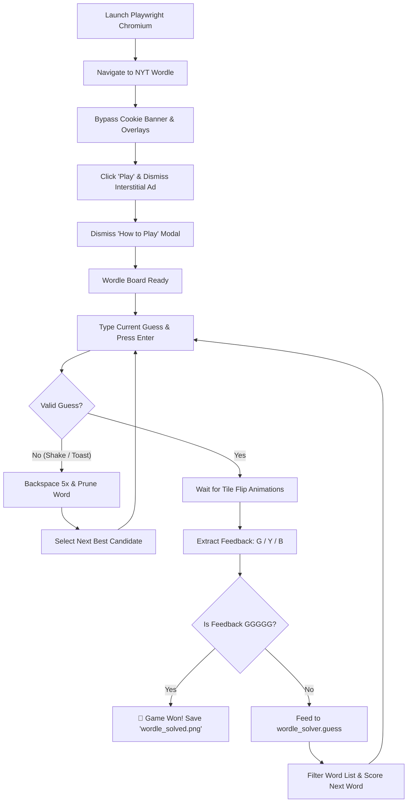

# NYT Wordle Automatic Solver

An automated bot that uses a headless (or headed) Chrome browser via Playwright to play and solve the daily [New York Times Wordle](https://www.nytimes.com/games/wordle/index.html) completely autonomously using the project's heuristic word solver.

---

## Features

- **Hands-Free Solving**: Automatically navigates to the NYT Wordle website, bypasses ads and consent modals, types guesses, reads tile feedback, and solves the puzzle.
- **Headless & Headed Modes**: Run silently in the background (default headless) or launch a visible browser (`--headed`) to watch it solve live.
- **Smart Modal & Interstitial Handling**: Automatically handles:
  - GDPR / Fides cookie consent overlays (`#fides-overlay`)
  - Full-screen NYT subscription interstitial ads (*"Continue to Wordle"*)
  - The introductory *"How to Play"* modal dialog
- **Animation-Aware DOM Parsing**: Waits for tile flip animations before reading `data-state` (`correct` / `present` / `absent`).
- **Invalid Word Fallback**: Detects if a suggested guess is rejected by NYT's dictionary (*"Not in word list"*), clears the input with backspaces, prunes the word from candidates, and tries the next best candidate.
- **Visual Proof**: Captures and saves a final screenshot of the completed board to `wordle_solved.png`.

---

## Prerequisites

1. **Python 3.10+**
2. **Playwright** library and Chromium browser:
   ```powershell
   pip install playwright
   playwright install chromium
   ```

---

## How to Use

### 1. Default (Headless Mode)
Runs the browser silently in the background, prints the progress in the console, and saves the final board screenshot to `wordle_solved.png`:
```powershell
python auto_solve_nyt.py
```

### 2. Headed Mode (Watch it live in a browser)
Opens a visible Chromium window so you can watch the bot enter guesses in real time:
```powershell
python auto_solve_nyt.py --headed
```

### 3. Custom Starting Word
By default, the bot starts with `CRANE`. You can specify any valid 5-letter starting word using the `--start` flag:
```powershell
python auto_solve_nyt.py --start slate
```

Combine flags to watch a custom run live:
```powershell
python auto_solve_nyt.py --headed --start adieu
```

---

## Command-Line Arguments

| Argument | Type | Default | Description |
| :--- | :--- | :--- | :--- |
| `--headed` | Flag | `False` (headless) | Opens a visible browser window instead of running headlessly. |
| `--start` | String | `"crane"` | The starting 5-letter word for the first attempt. |

---

## Output Example

When running `python auto_solve_nyt.py`, you will see output like:

```text
==================================================
      NYT WORDLE HEADLESS AUTOMATED SOLVER       
==================================================
Mode: Headless
Starting word: CRANE

Navigating to NYT Wordle...
Wordle grid detected! Starting solver loop...

--- Attempt 1/6: Trying 'CRANE' ---
Feedback: BBBBY  ⬛⬛⬛⬛🟨
Remaining candidates: 619
Next suggestion: 'BEFOG' (out of 1 top scored)

--- Attempt 2/6: Trying 'BEFOG' ---
Feedback: BYBYB  ⬛🟨⬛🟨⬛
Remaining candidates: 118
Next suggestion: 'OUZEL' (out of 1 top scored)

--- Attempt 3/6: Trying 'OUZEL' ---
Feedback: YBBGY  🟨⬛⬛🟩🟨
Remaining candidates: 19
Next suggestion: 'HOLEY' (out of 1 top scored)

--- Attempt 4/6: Trying 'HOLEY' ---
Feedback: GGGGG  🟩🟩🟩🟩🟩

🎉 SOLVED in 4 attempts! The word is 'HOLEY'.
Screenshot saved to 'wordle_solved.png'.
```

The resulting board screenshot is saved in the repository root as `wordle_solved.png`.

---

## How It Works



1. **Browser Initialization**: Playwright launches Chromium with an isolated browser context and custom viewport.
2. **Page Preparation**:
   - Locates and dismisses the GDPR / Fides consent overlay.
   - Clicks the primary **Play** button.
   - Detects the interstitial subscription advertisement and clicks **Continue to Wordle**.
   - Closes any introductory dialogs.
3. **Solving Loop**:
   - Sends keystrokes directly to the browser window.
   - Polls the 5 tiles corresponding to the active row until their `data-state` changes from `tbd` to `absent` (`B`), `present` (`Y`), or `correct` (`G`).
   - Translates colors to project feedback format (`B`, `Y`, `G`).
   - Calls `solver.guess()` from `wordle_solver.py` to filter remaining possible words and compute optimal letter distribution scores.
   - Repeats until solved or maximum 6 attempts reached.

---

## Troubleshooting

- **`playwright._impl._errors.Error: Executable doesn't exist`**:
  Run `playwright install chromium` in your terminal to ensure the browser binary is installed.
- **Slow Internet Connection**:
  If the page takes longer to load due to high latency, the script includes built-in retries for modals and buttons, waiting for the 30-tile grid before starting the solver loop.
